# 模板图鉴

[返回 README](README.md) · [使用模板](README.md#使用模板) · [提交模板](README.md#提交模板)

这里展示仓库中全部 **68 套封面模板**：原有 50 套横版封面、6 套已发布合集竖版封面，以及 12 套横向素材合集模板。两组新设计各六套，成品分别为 **1920 × 1080（16:9）** 和 **1200 × 1800（2:3）**；两组都使用横向背景素材。点击预览图可查看原图，模板文件链接可查看对应 JSON。

预览图用于展示布局与风格；在 Library Cover Studio 中使用时，标题、海报及背景会根据模板设置和媒体内容生成。

## 横向素材合集模板

两组各六套，全部使用成员影片的横向背景图或缩略图。通过 Store 按需添加，自动取横图需要应用 **1.11.0** 或更新版本。示例图展示排版，不表示这些影片属于同一合集。

### 横向素材 + 横版封面

#### 横景横封 · 放映时间轴

<a href="横版合集放映时间轴/preview.jpg">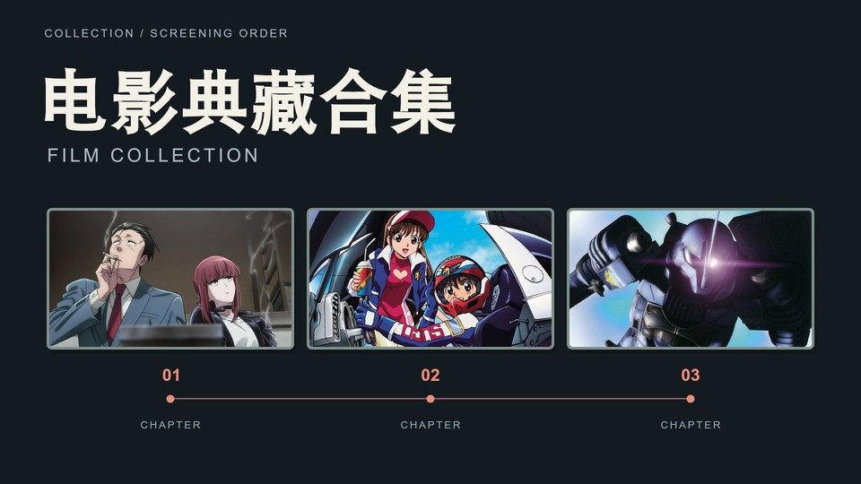</a>

**尺寸：** 1920 × 1080 · **版本：** 1.0.0 · **作者：** [HappyQuQu](https://github.com/HappyQuQu)

横版素材 + 横版封面。三张 16:9 成员背景图沿放映时间轴排列，顶部大标题与珊瑚红章节节点连接整个系列。优先读取 Backdrop，缺失时回退 Thumb 或海报。

[模板文件](横版合集放映时间轴/template.json) · [查看原图](横版合集放映时间轴/preview.jpg)

#### 横景横封 · 红幕首映

<a href="横版合集红幕首映/preview.jpg">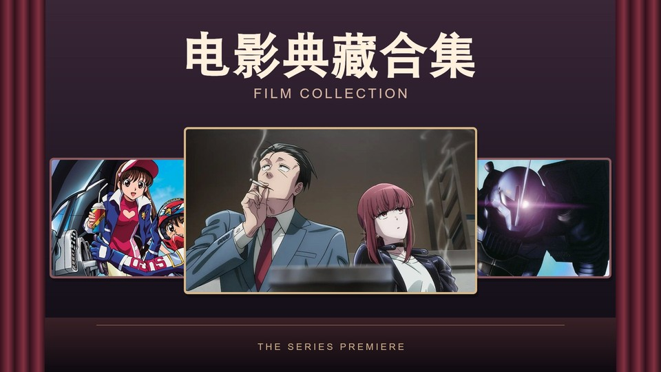</a>

**尺寸：** 1920 × 1080 · **版本：** 1.0.0 · **作者：** [HappyQuQu](https://github.com/HappyQuQu)

横版素材 + 横版封面。酒红幕布、居中标题，三幅宽银幕背景图层叠在舞台中央，首幅影片背景作为主视觉。使用 3 张横图。

[模板文件](横版合集红幕首映/template.json) · [查看原图](横版合集红幕首映/preview.jpg)

#### 横景横封 · 典藏书盒

<a href="横版合集典藏书盒/preview.jpg">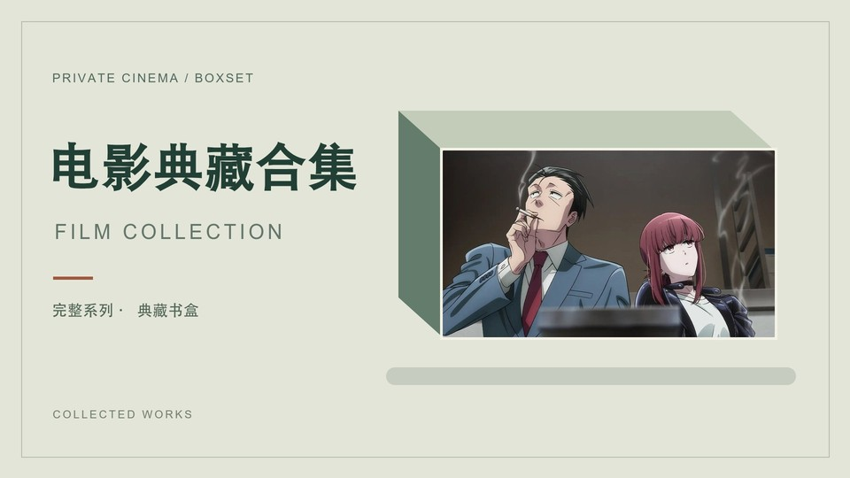</a>

**尺寸：** 1920 × 1080 · **版本：** 1.0.0 · **作者：** [HappyQuQu](https://github.com/HappyQuQu)

横版素材 + 横版封面。暖灰绿桌面与横向典藏书盒，单幅影片背景作为完整书盒正面，侧面和顶面构成立体封套。使用 1 张横图。

[模板文件](横版合集典藏书盒/template.json) · [查看原图](横版合集典藏书盒/preview.jpg)

#### 横景横封 · 连环分镜

<a href="横版合集连环分镜/preview.jpg">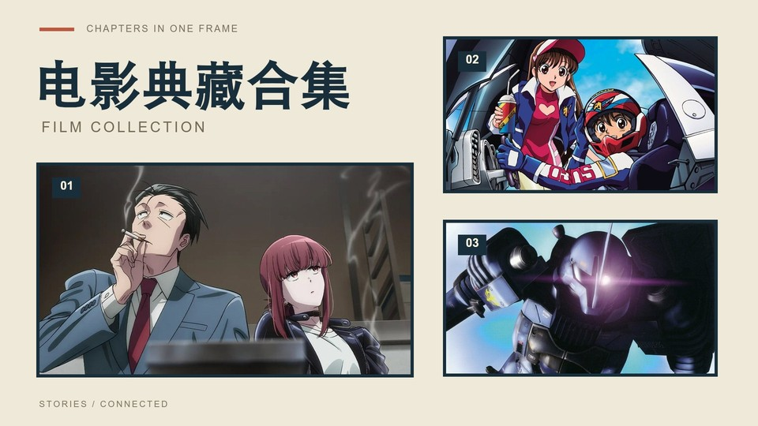</a>

**尺寸：** 1920 × 1080 · **版本：** 1.0.0 · **作者：** [HappyQuQu](https://github.com/HappyQuQu)

横版素材 + 横版封面。一幅大分镜配两幅横向副分镜，粗边框与珊瑚色章节索引形成连环画式编排。使用 3 张横图。

[模板文件](横版合集连环分镜/template.json) · [查看原图](横版合集连环分镜/preview.jpg)

#### 横景横封 · 折页连章

<a href="横版合集折页连章/preview.jpg">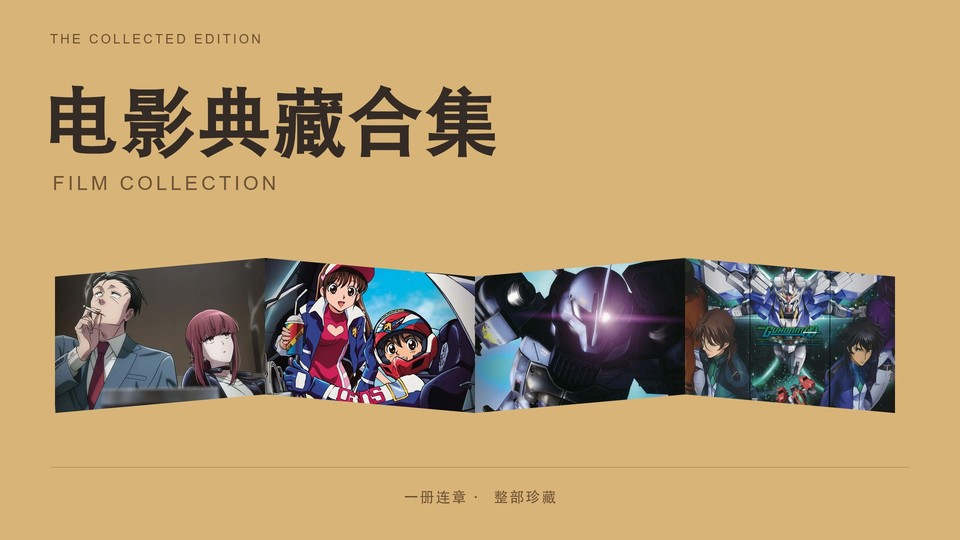</a>

**尺寸：** 1920 × 1080 · **版本：** 1.0.0 · **作者：** [HappyQuQu](https://github.com/HappyQuQu)

横版素材 + 横版封面。四幅宽景展开为手风琴式折页，姜黄纸面、大标题与折缝阴影营造系列画册感。使用 4 张横图。

[模板文件](横版合集折页连章/template.json) · [查看原图](横版合集折页连章/preview.jpg)

#### 横景横封 · 三色片夹

<a href="横版合集三色片夹/preview.jpg">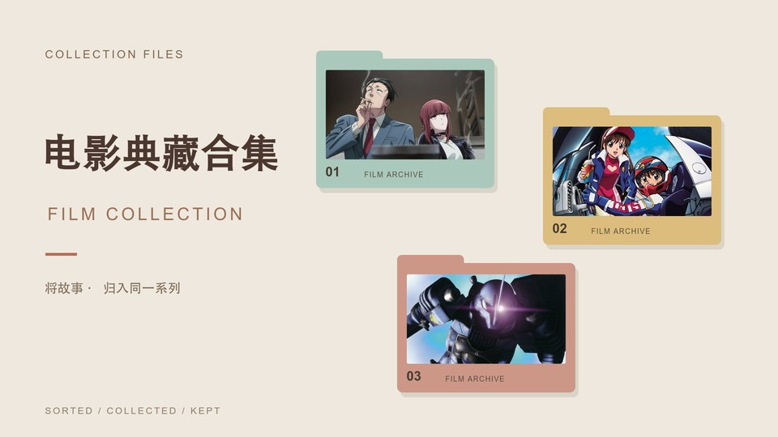</a>

**尺寸：** 1920 × 1080 · **版本：** 1.0.0 · **作者：** [HappyQuQu](https://github.com/HappyQuQu)

横版素材 + 横版封面。浅色片库桌面、左侧大标题，三只彩色片夹收纳完整比例的横向影片背景。使用 3 张横图。

[模板文件](横版合集三色片夹/template.json) · [查看原图](横版合集三色片夹/preview.jpg)

### 横向素材 + 竖版封面

#### 横景竖封 · 双幕留白

<a href="横景竖封双幕留白/preview.jpg">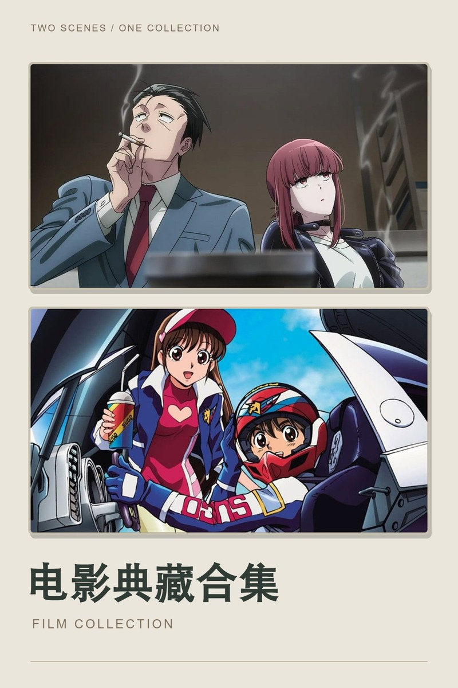</a>

**尺寸：** 1200 × 1800 · **版本：** 1.0.0 · **作者：** [HappyQuQu](https://github.com/HappyQuQu)

横版素材 + 竖版封面。两幅 16:9 背景图上下陈列，暖白留边与底部大标题组成简洁双幕画册。使用 2 张横图。

[模板文件](横景竖封双幕留白/template.json) · [查看原图](横景竖封双幕留白/preview.jpg)

#### 横景竖封 · 三幕长廊

<a href="横景竖封三幕长廊/preview.jpg">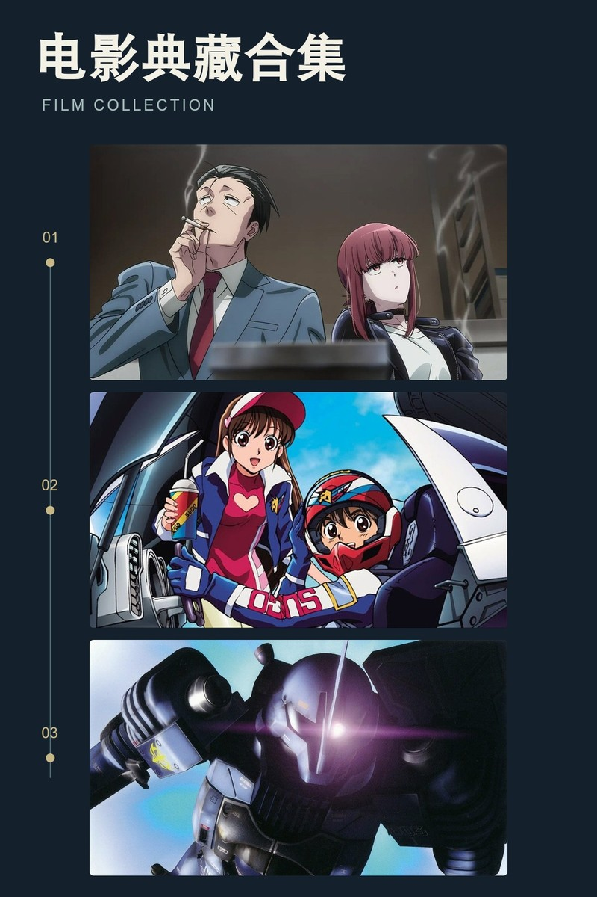</a>

**尺寸：** 1200 × 1800 · **版本：** 1.0.0 · **作者：** [HappyQuQu](https://github.com/HappyQuQu)

横版素材 + 竖版封面。三幅完整比例背景图沿细长展览索引上下排列，深蓝底色与清晰标题衬托横向场景。使用 3 张横图。

[模板文件](横景竖封三幕长廊/template.json) · [查看原图](横景竖封三幕长廊/preview.jpg)

#### 横景竖封 · 银幕便笺

<a href="横景竖封银幕便笺/preview.jpg">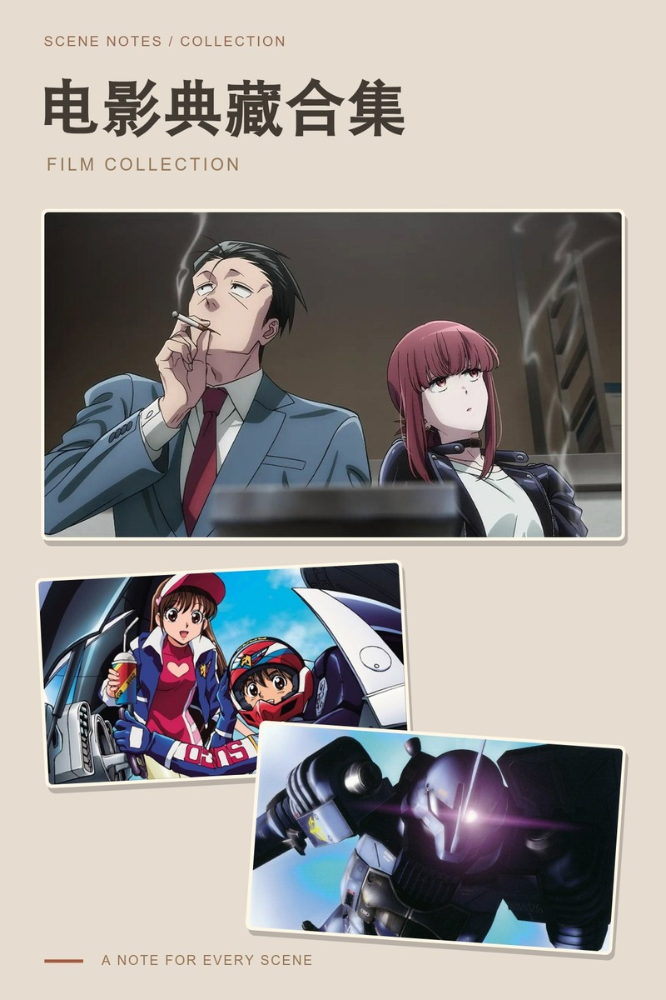</a>

**尺寸：** 1200 × 1800 · **版本：** 1.0.0 · **作者：** [HappyQuQu](https://github.com/HappyQuQu)

横版素材 + 竖版封面。一幅宽景主图与两张错落便笺，奶油纸面、手册式标题和朱红索引组成影片收藏页。使用 3 张横图。

[模板文件](横景竖封银幕便笺/template.json) · [查看原图](横景竖封银幕便笺/preview.jpg)

#### 横景竖封 · 浮光灯箱

**尺寸：** 1200 × 1800 · **版本：** 1.0.0 · **作者：** [HappyQuQu](https://github.com/HappyQuQu)

横版素材 + 竖版封面。三张横向剧照以细光框错角层叠，深紫蓝背景与顶部标题构成夜间灯箱画面。使用 3 张横图。

[模板文件](横景竖封浮光灯箱/template.json) · [查看原图](横景竖封浮光灯箱/preview.jpg)

#### 横景竖封 · 幕间书签

<a href="横景竖封幕间书签/preview.jpg">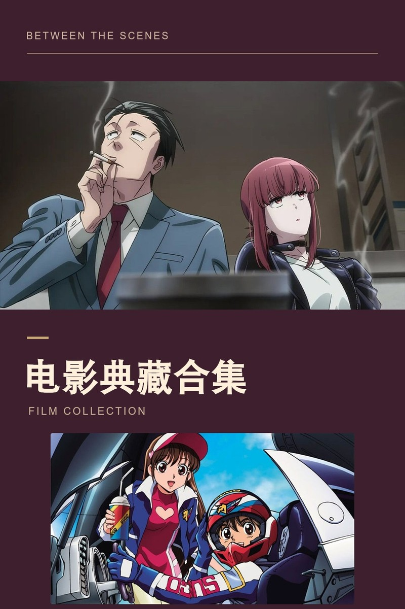</a>

**尺寸：** 1200 × 1800 · **版本：** 1.0.0 · **作者：** [HappyQuQu](https://github.com/HappyQuQu)

横版素材 + 竖版封面。两幅宽银幕场景之间插入酒红书签式标题区，暖金线条与深红留白形成幕间停顿。使用 2 张横图。

[模板文件](横景竖封幕间书签/template.json) · [查看原图](横景竖封幕间书签/preview.jpg)

#### 横景竖封 · 黑白场记

<a href="横景竖封黑白场记/preview.jpg">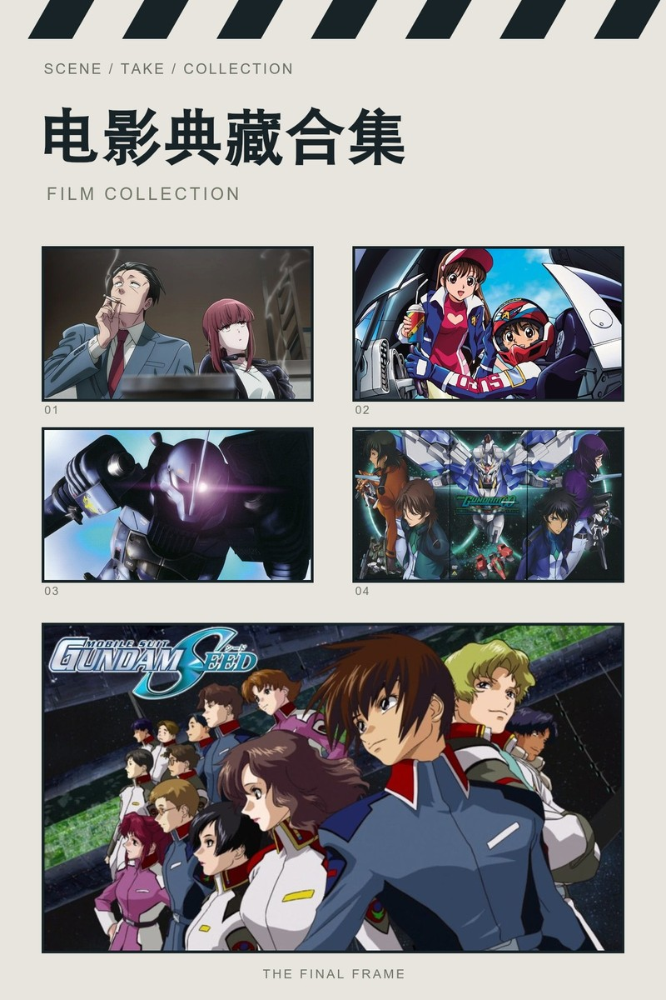</a>

**尺寸：** 1200 × 1800 · **版本：** 1.0.0 · **作者：** [HappyQuQu](https://github.com/HappyQuQu)

横版素材 + 竖版封面。黑白场记板标题、四格横图与底部宽幅主幕组成五场系列目录。使用 5 张横图。

[模板文件](横景竖封黑白场记/template.json) · [查看原图](横景竖封黑白场记/preview.jpg)

## 合集专用竖版模板

六套 2:3 竖版封面，适合 Jellyfin / Emby 的合集海报卡片，避免横版封面放进竖版卡片时上下留空。需要应用 1.10.0 或更新版本，通过商店按需添加，不属于七套默认初始化模板。合集名称和副标题可编辑，成员海报不足时会复用已有图片。以下使用项目示例海报展示布局，不代表同一影片系列。

[合集 · 黑金典藏](#合集--黑金典藏) · [合集 · 画册索引](#合集--画册索引) · [合集 · 六幕系列](#合集--六幕系列) · [合集 · 胶片长卷](#合集--胶片长卷) · [合集 · 极夜叠映](#合集--极夜叠映) · [合集 · 斜幕拼章](#合集--斜幕拼章)

### 合集 · 黑金典藏

**商店名称：** 合集 · 黑金典藏 · **尺寸：** 1200 × 1800 · **版本：** 1.0.0 · **作者：** [HappyQuQu](https://github.com/HappyQuQu)

首张成员海报铺满封套，底部暗幕保护合集标题，金色细框与典藏索引。使用 1 张海报，适合希望保留一张主视觉的系列合集。

[模板文件](合集黑金典藏/template.json) · [查看原图](合集黑金典藏/preview.jpg)

### 合集 · 画册索引

<a href="合集画册索引/preview.jpg">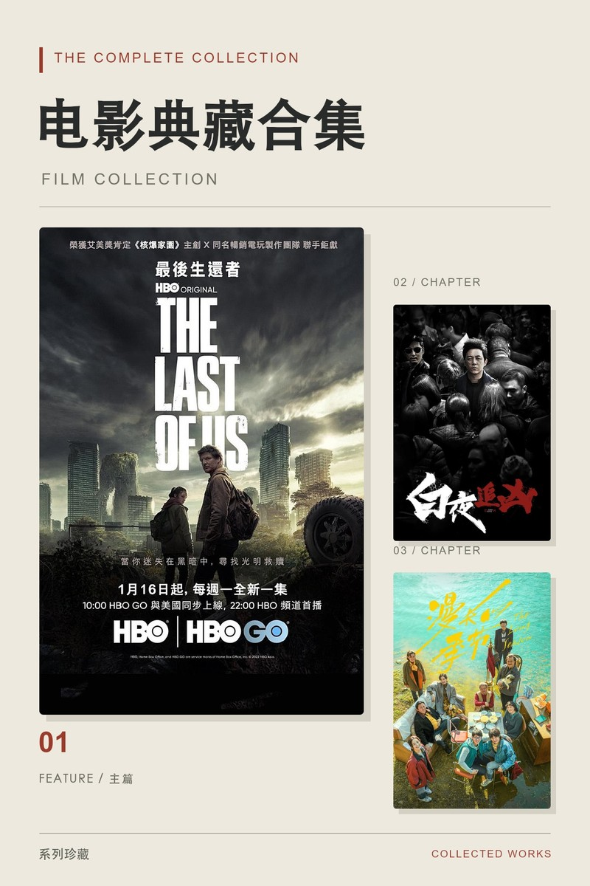</a>

**商店名称：** 合集 · 画册索引 · **尺寸：** 1200 × 1800 · **版本：** 1.0.0 · **作者：** [HappyQuQu](https://github.com/HappyQuQu)

暖白画册配朱红索引，一幅主图与两幅成员海报分栏编排，顶部保留清晰的合集标题。使用 3 张海报，适合三部曲或小型系列。

[模板文件](合集画册索引/template.json) · [查看原图](合集画册索引/preview.jpg)

### 合集 · 六幕系列

**商店名称：** 合集 · 六幕系列 · **尺寸：** 1200 × 1800 · **版本：** 1.0.0 · **作者：** [HappyQuQu](https://github.com/HappyQuQu)

首张成员海报模糊压暗作为背景，六张完整比例海报组成两排系列目录。使用 6 张海报，适合希望展示多部成员作品的合集。

[模板文件](合集六幕系列/template.json) · [查看原图](合集六幕系列/preview.jpg)

### 合集 · 胶片长卷

<a href="合集胶片长卷/preview.jpg">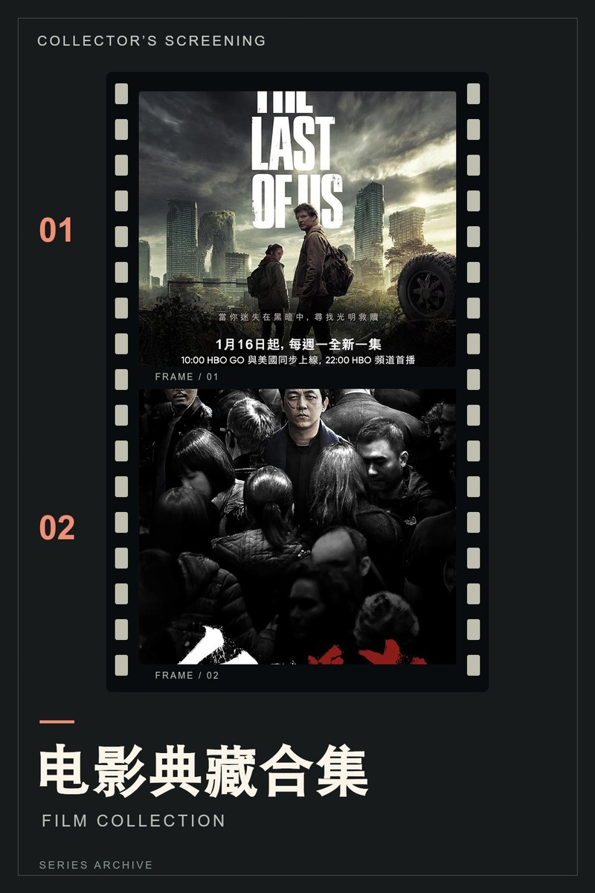</a>

**商店名称：** 合集 · 胶片长卷 · **尺寸：** 1200 × 1800 · **版本：** 1.0.0 · **作者：** [HappyQuQu](https://github.com/HappyQuQu)

两格竖向胶片搭配齿孔、珊瑚红索引与底部大标题，使用 2 张成员海报。适合双片系列；图片裁成胶片画幅，文字和图层均可编辑。

[模板文件](合集胶片长卷/template.json) · [查看原图](合集胶片长卷/preview.jpg)

### 合集 · 极夜叠映

**商店名称：** 合集 · 极夜叠映 · **尺寸：** 1200 × 1800 · **版本：** 1.0.0 · **作者：** [HappyQuQu](https://github.com/HappyQuQu)

深紫幕布与居中大标题，三张圆角成员海报向两侧展开叠放，前景突出首张海报。使用 3 张海报，首张海报模糊压暗作为背景，两侧卡片保留画布内留白。

[模板文件](合集极夜叠映/template.json) · [查看原图](合集极夜叠映/preview.jpg)

### 合集 · 斜幕拼章

**商店名称：** 合集 · 斜幕拼章 · **尺寸：** 1200 × 1800 · **版本：** 1.0.0 · **作者：** [HappyQuQu](https://github.com/HappyQuQu)

三幅斜向成员海报铺满上半部，搭配鼠尾草绿斜切标题带和深色大标题。使用 3 张海报，适合三部曲；保留相对多边形蒙版，可继续编辑和自动替换素材。

[模板文件](合集斜幕拼章/template.json) · [查看原图](合集斜幕拼章/preview.jpg)

## 系统默认模板

应用首次初始化会安装以下 7 套模板，也可在「模板商店」中查看和更新。

[柔彩扇形](#柔彩扇形) · [直列海报墙](#直列海报墙) · [倾斜圆角海报墙](#倾斜圆角海报墙) · [斜切大图](#斜切大图) · [柔雾居中标题](#柔雾居中标题) · [圆角叠卡](#圆角叠卡) · [横幅背景海报列](#横幅背景海报列)

### 柔彩扇形

**商店名称：** 柔彩扇形 · **尺寸：** 1920 × 1080 · **版本：** 1.0.0 · **作者：** [HappyQuQu](https://github.com/HappyQuQu)

居中双标题、五张圆角海报扇形排列。每次生成按柔彩渐变风格随机配色，海报与标题自动替换。

[模板文件](柔彩扇形/template.json) · [查看原图](柔彩扇形/preview.jpg)

### 直列海报墙

**商店名称：** 直列海报墙 · **尺寸：** 1920 × 1080 · **版本：** 1.0.0 · **作者：** [HappyQuQu](https://github.com/HappyQuQu)

左侧大标题、右侧 2/3 画幅铺满竖直无缝海报墙，无间距、无圆角留白。每次生成随机同色系底色与点缀色，海报与标题自动替换。

[模板文件](直列海报墙/template.json) · [查看原图](直列海报墙/preview.jpg)

### 倾斜圆角海报墙

**商店名称：** 倾斜圆角海报墙 · **尺寸：** 1920 × 1080 · **版本：** 1.0.0 · **作者：** [HappyQuQu](https://github.com/HappyQuQu)

左侧大标题，右侧九张圆角海报倾斜排列。使用首张海报的模糊压暗背景，保留海报间距、阴影和斜向边界，海报与标题自动替换。

[模板文件](倾斜圆角海报墙/template.json) · [查看原图](倾斜圆角海报墙/preview.jpg)

### 斜切大图

**商店名称：** 斜切大图 · **尺寸：** 1920 × 1080 · **版本：** 1.0.0 · **作者：** [HappyQuQu](https://github.com/HappyQuQu)

左侧主副标题，右侧一张斜切大图铺到边缘，适合精选影片与分类封面。标题与图片自动替换，柔雾背景按样式随机配色。

[模板文件](斜切大图/template.json) · [查看原图](斜切大图/preview.jpg)

### 柔雾居中标题

**商店名称：** 柔雾居中标题 · **尺寸：** 1920 × 1080 · **版本：** 1.0.0 · **作者：** [HappyQuQu](https://github.com/HappyQuQu)

柔雾渐变背景、居中大标题与衬线斜体副标题，副标题自动换行。无需图片，适合简洁分类封面，背景按样式随机配色。

[模板文件](柔雾居中标题/template.json) · [查看原图](柔雾居中标题/preview.jpg)

### 圆角叠卡

**商店名称：** 圆角叠卡 · **尺寸：** 1920 × 1080 · **版本：** 1.0.0 · **作者：** [HappyQuQu](https://github.com/HappyQuQu)

左侧主副标题，右侧圆角主海报和两张半透明叠卡。三层共用同一张可替换图片，柔雾背景按样式随机配色。

[模板文件](圆角叠卡/template.json) · [查看原图](圆角叠卡/preview.jpg)

### 横幅背景海报列

**商店名称：** 横幅背景海报列 · **尺寸：** 1920 × 1080 · **版本：** 1.0.0 · **作者：** [HappyQuQu](https://github.com/HappyQuQu)

首个影片的横向背景图铺满画面，左上主副标题，底部五张直立圆角海报。背景缺失时回退首张海报，可调整模糊和压暗。

[模板文件](横幅背景海报列/template.json) · [查看原图](横幅背景海报列/preview.jpg)

## 社区试作模板

以下 7 套模板需要在「模板商店」中按需下载，添加后可在设计器中继续编辑。

[票根收藏](#票根收藏) · [胶片放映](#胶片放映) · [黑胶唱片](#黑胶唱片) · [影像画册](#影像画册) · [轨道星图](#轨道星图) · [四幕蒙太奇](#四幕蒙太奇) · [蜂巢拼图](#蜂巢拼图)

### 票根收藏

**商店名称：** 试作 · 票根收藏 · **尺寸：** 1920 × 1080 · **版本：** 1.0.0 · **作者：** [HappyQuQu](https://github.com/HappyQuQu)

大幅票根纸面、左侧单张海报、右侧主副标题，带齿孔与编号装饰。

[模板文件](票根收藏/template.json) · [查看原图](票根收藏/preview.jpg)

### 胶片放映

[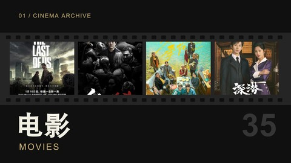](胶片放映/preview.jpg)

**商店名称：** 试作 · 胶片放映 · **尺寸：** 1920 × 1080 · **版本：** 1.0.0 · **作者：** [HappyQuQu](https://github.com/HappyQuQu)

横贯画面的四格胶片与上下齿孔，底部大标题；四张图片按横向画幅裁切。

[模板文件](胶片放映/template.json) · [查看原图](胶片放映/preview.jpg)

### 黑胶唱片

[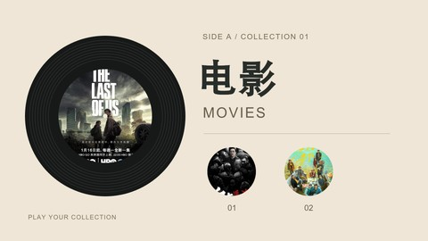](黑胶唱片/preview.jpg)

**商店名称：** 试作 · 黑胶唱片 · **尺寸：** 1920 × 1080 · **版本：** 1.0.0 · **作者：** [HappyQuQu](https://github.com/HappyQuQu)

左侧唱片刻纹与圆形海报唱片标签，右侧标题和两枚独立圆形封面。

[模板文件](黑胶唱片/template.json) · [查看原图](黑胶唱片/preview.jpg)

### 影像画册

[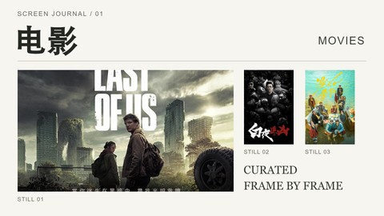](影像画册/preview.jpg)

**商店名称：** 试作 · 影像画册 · **尺寸：** 1920 × 1080 · **版本：** 1.0.0 · **作者：** [HappyQuQu](https://github.com/HappyQuQu)

上方刊物式大标题、左下横向主视觉、右侧双图与图注的杂志编排。

[模板文件](影像画册/template.json) · [查看原图](影像画册/preview.jpg)

### 轨道星图

**商店名称：** 试作 · 轨道星图 · **尺寸：** 1920 × 1080 · **版本：** 1.0.0 · **作者：** [HappyQuQu](https://github.com/HappyQuQu)

五枚圆形海报沿椭圆轨道分布，标题位于中央留白，带细线与星图节点。

[模板文件](轨道星图/template.json) · [查看原图](轨道星图/preview.jpg)

### 四幕蒙太奇

**商店名称：** 试作 · 四幕蒙太奇 · **尺寸：** 1920 × 1080 · **版本：** 1.0.0 · **作者：** [HappyQuQu](https://github.com/HappyQuQu)

四幅横向裁切画面铺满四角，中央横贯标题带，适合强调多部影片的分类封面。

[模板文件](四幕蒙太奇/template.json) · [查看原图](四幕蒙太奇/preview.jpg)

### 蜂巢拼图

[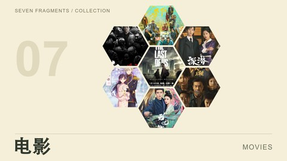](蜂巢拼图/preview.jpg)

**商店名称：** 试作 · 蜂巢拼图 · **尺寸：** 1920 × 1080 · **版本：** 1.0.0 · **作者：** [HappyQuQu](https://github.com/HappyQuQu)

七张六边形海报组成蜂巢，底部主副标题与浅色画册背景。

[模板文件](蜂巢拼图/template.json) · [查看原图](蜂巢拼图/preview.jpg)

## 深色试作模板

以下 7 套使用固定深色配色与独立构图，支持可编辑的标题、图片和装饰图层，在商店按需添加，不参与默认初始化。

[黑金展台](#黑金展台) · [午夜阶梯](#午夜阶梯) · [赤焰快门](#赤焰快门) · [全景夜航](#全景夜航) · [霓虹橱窗](#霓虹橱窗) · [银幕折页](#银幕折页) · [碎片棱镜](#碎片棱镜)

### 黑金展台

[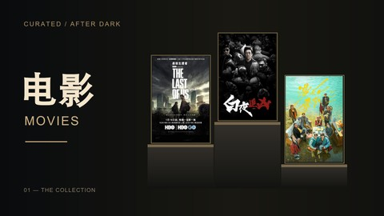](黑金展台/preview.jpg)

**商店名称：** 深色试作 · 黑金展台 · **尺寸：** 1920 × 1080 · **版本：** 1.0.0 · **作者：** [HappyQuQu](https://github.com/HappyQuQu)

炭黑与香槟金，三张海报陈列在高低展台上，左侧大标题。

[模板文件](黑金展台/template.json) · [查看原图](黑金展台/preview.jpg)

### 午夜阶梯

[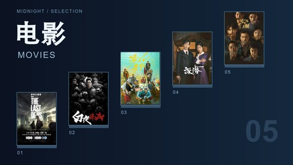](午夜阶梯/preview.jpg)

**商店名称：** 深色试作 · 午夜阶梯 · **尺寸：** 1920 × 1080 · **版本：** 1.0.0 · **作者：** [HappyQuQu](https://github.com/HappyQuQu)

五张直立海报沿阶梯逐级上升，午夜蓝底色与独立图号。

[模板文件](午夜阶梯/template.json) · [查看原图](午夜阶梯/preview.jpg)

### 赤焰快门

**商店名称：** 深色试作 · 赤焰快门 · **尺寸：** 1920 × 1080 · **版本：** 1.0.0 · **作者：** [HappyQuQu](https://github.com/HappyQuQu)

三幅长条海报裁成斜向快门，暗红背景、珊瑚色细边。

[模板文件](赤焰快门/template.json) · [查看原图](赤焰快门/preview.jpg)

### 全景夜航

[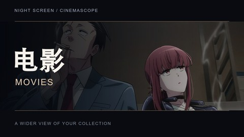](全景夜航/preview.jpg)

**商店名称：** 深色试作 · 全景夜航 · **尺寸：** 1920 × 1080 · **版本：** 1.0.0 · **作者：** [HappyQuQu](https://github.com/HappyQuQu)

首部影片背景作为宽银幕画面，上下黑边、左侧大标题与暗幕。背景缺失时使用首张海报，无需额外的前景海报。

[模板文件](全景夜航/template.json) · [查看原图](全景夜航/preview.jpg)

### 霓虹橱窗

[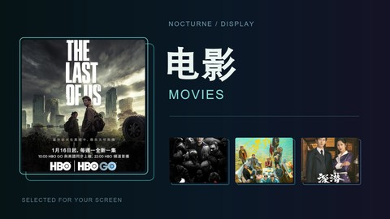](霓虹橱窗/preview.jpg)

**商店名称：** 深色试作 · 霓虹橱窗 · **尺寸：** 1920 × 1080 · **版本：** 1.0.0 · **作者：** [HappyQuQu](https://github.com/HappyQuQu)

一幅大图与三幅横向小图组成橱窗，细青色边框与错位光框。

[模板文件](霓虹橱窗/template.json) · [查看原图](霓虹橱窗/preview.jpg)

### 银幕折页

[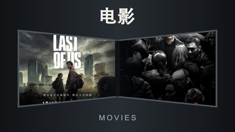](银幕折页/preview.jpg)

**商店名称：** 深色试作 · 银幕折页 · **尺寸：** 1920 × 1080 · **版本：** 1.0.0 · **作者：** [HappyQuQu](https://github.com/HappyQuQu)

两幅画面组成向中央收拢的折页银幕，带书脊阴影。

[模板文件](银幕折页/template.json) · [查看原图](银幕折页/preview.jpg)

### 碎片棱镜

**商店名称：** 深色试作 · 碎片棱镜 · **尺寸：** 1920 × 1080 · **版本：** 1.0.0 · **作者：** [HappyQuQu](https://github.com/HappyQuQu)

九张海报裁成菱形碎片，错落排列在右侧，左侧大标题。

[模板文件](碎片棱镜/template.json) · [查看原图](碎片棱镜/preview.jpg)

## 精选主题模板

新增 29 套，分为五组风格。每套可在设计器继续编辑，支持媒体库标题与海报变量，使用系统字体；最低应用版本为 1.5.0。通过商店按需添加，不参与默认初始化。

[纸面与展览](#纸面与展览) · [光影与电影](#光影与电影) · [几何与空间](#几何与空间) · [编排与收藏](#编排与收藏) · [柔光与想象](#柔光与想象)

### 纸面与展览

[层叠画框](#层叠画框) · [云端书签](#云端书签) · [胶囊视窗](#胶囊视窗) · [展签留白](#展签留白) · [邮票旅行](#邮票旅行) · [拼贴便笺](#拼贴便笺)

#### 层叠画框

[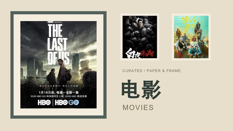](层叠画框/preview.jpg)

**商店名称：** 精选 · 层叠画框 · **尺寸：** 1920 × 1080 · **版本：** 1.0.0 · **作者：** [HappyQuQu](https://github.com/HappyQuQu)

暖纸色双重卡纸画框，大幅主图与两张右侧小图，右下标题。

素材：3 张海报。

[模板文件](层叠画框/template.json) · [查看原图](层叠画框/preview.jpg)

#### 云端书签

**商店名称：** 精选 · 云端书签 · **尺寸：** 1920 × 1080 · **版本：** 1.0.0 · **作者：** [HappyQuQu](https://github.com/HappyQuQu)

粉蓝留白与中央书签长条，主图居中，两张圆形图片分居标题两侧。

素材：3 张海报。

[模板文件](云端书签/template.json) · [查看原图](云端书签/preview.jpg)

#### 胶囊视窗

**商店名称：** 精选 · 胶囊视窗 · **尺寸：** 1920 × 1080 · **版本：** 1.0.0 · **作者：** [HappyQuQu](https://github.com/HappyQuQu)

三幅横向胶囊视窗按不同宽度上下展开，左側大标题与暖白背景。

素材：3 张海报。

[模板文件](胶囊视窗/template.json) · [查看原图](胶囊视窗/preview.jpg)

#### 展签留白

**商店名称：** 精选 · 展签留白 · **尺寸：** 1920 × 1080 · **版本：** 1.0.0 · **作者：** [HappyQuQu](https://github.com/HappyQuQu)

右侧独立画作与下方展签，左侧大标题和细线，宽阔暖灰留白。

素材：1 张海报。

[模板文件](展签留白/template.json) · [查看原图](展签留白/preview.jpg)

#### 邮票旅行

**商店名称：** 精选 · 邮票旅行 · **尺寸：** 1920 × 1080 · **版本：** 1.0.0 · **作者：** [HappyQuQu](https://github.com/HappyQuQu)

四幅海报装入邮票齿孔边框，错落分布在蓝灰纸面，左上标题。

素材：4 张海报。

[模板文件](邮票旅行/template.json) · [查看原图](邮票旅行/preview.jpg)

#### 拼贴便笺

[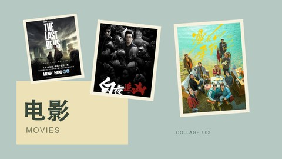](拼贴便笺/preview.jpg)

**商店名称：** 精选 · 拼贴便笺 · **尺寸：** 1920 × 1080 · **版本：** 1.0.0 · **作者：** [HappyQuQu](https://github.com/HappyQuQu)

三张白边照片轻微交叠，便笺色标题区与手账式线条，照片均留在画布内。

素材：3 张海报。

[模板文件](拼贴便笺/template.json) · [查看原图](拼贴便笺/preview.jpg)

### 光影与电影

[极光隧道](#极光隧道) · [地平银幕](#地平银幕) · [摄影暗房](#摄影暗房) · [镜头光圈](#镜头光圈) · [档案抽屉](#档案抽屉) · [夜刊封面](#夜刊封面)

#### 极光隧道

**商店名称：** 精选 · 极光隧道 · **尺寸：** 1920 × 1080 · **版本：** 1.0.0 · **作者：** [HappyQuQu](https://github.com/HappyQuQu)

重叠的青紫色矩形光门围绕单张海报，左侧大标题与暗蓝背景。

素材：1 张海报。

[模板文件](极光隧道/template.json) · [查看原图](极光隧道/preview.jpg)

#### 地平银幕

[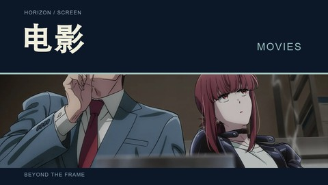](地平银幕/preview.jpg)

**商店名称：** 精选 · 地平银幕 · **尺寸：** 1920 × 1080 · **版本：** 1.0.0 · **作者：** [HappyQuQu](https://github.com/HappyQuQu)

上方深蓝标题区域与下方宽幅影片背景，地平线亮色细带连接两部分。

素材：首部影片背景，缺失时回退海报。

[模板文件](地平银幕/template.json) · [查看原图](地平银幕/preview.jpg)

#### 摄影暗房

[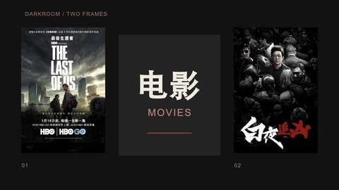](摄影暗房/preview.jpg)

**商店名称：** 精选 · 摄影暗房 · **尺寸：** 1920 × 1080 · **版本：** 1.0.0 · **作者：** [HappyQuQu](https://github.com/HappyQuQu)

两侧各一幅高对比大海报，中间窄幅标题区，暗房红色标识与黑色底面。

素材：2 张海报。

[模板文件](摄影暗房/template.json) · [查看原图](摄影暗房/preview.jpg)

#### 镜头光圈

**商店名称：** 精选 · 镜头光圈 · **尺寸：** 1920 × 1080 · **版本：** 1.0.0 · **作者：** [HappyQuQu](https://github.com/HappyQuQu)

单张圆形海报置于十二瓣镜头光圈中，左侧大标题，石墨灰与铜色细线。

素材：1 张海报。

[模板文件](镜头光圈/template.json) · [查看原图](镜头光圈/preview.jpg)

#### 档案抽屉

[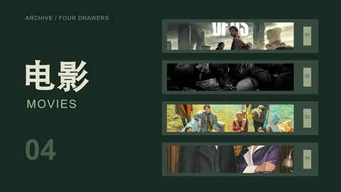](档案抽屉/preview.jpg)

**商店名称：** 精选 · 档案抽屉 · **尺寸：** 1920 × 1080 · **版本：** 1.0.0 · **作者：** [HappyQuQu](https://github.com/HappyQuQu)

四幅横向海报置于垂直叠放的抽屉中，左侧编号与大标题，深绿档案柜风格。

素材：4 张海报。

[模板文件](档案抽屉/template.json) · [查看原图](档案抽屉/preview.jpg)

#### 夜刊封面

[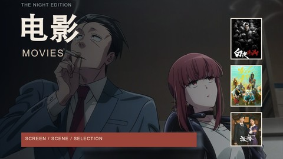](夜刊封面/preview.jpg)

**商店名称：** 精选 · 夜刊封面 · **尺寸：** 1920 × 1080 · **版本：** 1.0.0 · **作者：** [HappyQuQu](https://github.com/HappyQuQu)

影片背景铺满封面，上方大刊名、右侧三张竖排选片，底部红色索引条。

素材：首部影片背景及三张前景海报；背景缺失时回退首张海报。

[模板文件](夜刊封面/template.json) · [查看原图](夜刊封面/preview.jpg)

### 几何与空间

[三角拼版](#三角拼版) · [弧线长廊](#弧线长廊) · [拱门广场](#拱门广场) · [宝石切面](#宝石切面) · [网格脉冲](#网格脉冲) · [黑白棋盘](#黑白棋盘)

#### 三角拼版

**商店名称：** 精选 · 三角拼版 · **尺寸：** 1920 × 1080 · **版本：** 1.0.0 · **作者：** [HappyQuQu](https://github.com/HappyQuQu)

六张三角海报拼成三组上下呼应的图形，底部居中标题，浅杏色背景。

素材：6 张海报。

[模板文件](三角拼版/template.json) · [查看原图](三角拼版/preview.jpg)

#### 弧线长廊

[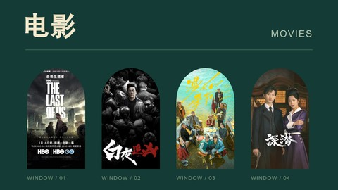](弧线长廊/preview.jpg)

**商店名称：** 精选 · 弧线长廊 · **尺寸：** 1920 × 1080 · **版本：** 1.0.0 · **作者：** [HappyQuQu](https://github.com/HappyQuQu)

四扇等距拱形视窗组成长廊，上方大标题与细线，深墨绿底色。

素材：4 张海报。

[模板文件](弧线长廊/template.json) · [查看原图](弧线长廊/preview.jpg)

#### 拱门广场

**商店名称：** 精选 · 拱门广场 · **尺寸：** 1920 × 1080 · **版本：** 1.0.0 · **作者：** [HappyQuQu](https://github.com/HappyQuQu)

右侧一扇巨大的拱门主图，左侧三扇小窗，暖白标题与砖红庭院。

素材：4 张海报。

[模板文件](拱门广场/template.json) · [查看原图](拱门广场/preview.jpg)

#### 宝石切面

[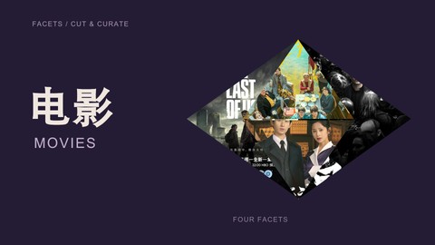](宝石切面/preview.jpg)

**商店名称：** 精选 · 宝石切面 · **尺寸：** 1920 × 1080 · **版本：** 1.0.0 · **作者：** [HappyQuQu](https://github.com/HappyQuQu)

四幅三角切面组成一枚大菱形宝石，左侧标题，深紫色与香槟色线条。

素材：4 张海报。

[模板文件](宝石切面/template.json) · [查看原图](宝石切面/preview.jpg)

#### 网格脉冲

[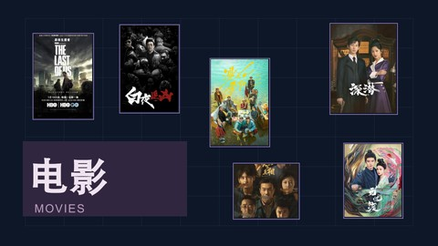](网格脉冲/preview.jpg)

**商店名称：** 精选 · 网格脉冲 · **尺寸：** 1920 × 1080 · **版本：** 1.0.0 · **作者：** [HappyQuQu](https://github.com/HappyQuQu)

六幅小海报落在细线网格的不同节点，错落分布，左下紫色标题区域。

素材：6 张海报。

[模板文件](网格脉冲/template.json) · [查看原图](网格脉冲/preview.jpg)

#### 黑白棋盘

**商店名称：** 精选 · 黑白棋盘 · **尺寸：** 1920 × 1080 · **版本：** 1.0.0 · **作者：** [HappyQuQu](https://github.com/HappyQuQu)

两侧交错的黑白方格嵌入四幅海报，中央标题穿过棋盘留白。

素材：4 张海报。

[模板文件](黑白棋盘/template.json) · [查看原图](黑白棋盘/preview.jpg)

### 编排与收藏

[交错书脊](#交错书脊) · [电影日历](#电影日历) · [编号海报](#编号海报) · [双页对照](#双页对照) · [模块仪表](#模块仪表) · [竖幅画卷](#竖幅画卷)

#### 交错书脊

**商店名称：** 精选 · 交错书脊 · **尺寸：** 1920 × 1080 · **版本：** 1.0.0 · **作者：** [HappyQuQu](https://github.com/HappyQuQu)

六张高窄海报组成书脊序列，海报顶边参差，底部大标题与暖木色。

素材：6 张海报。

[模板文件](交错书脊/template.json) · [查看原图](交错书脊/preview.jpg)

#### 电影日历

[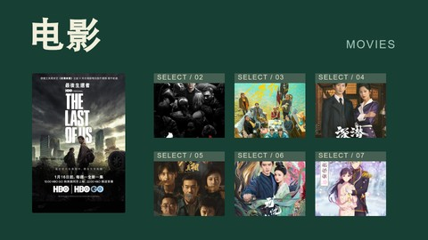](电影日历/preview.jpg)

**商店名称：** 精选 · 电影日历 · **尺寸：** 1920 × 1080 · **版本：** 1.0.0 · **作者：** [HappyQuQu](https://github.com/HappyQuQu)

一张大海报与六格选片日历并排，绿色章节标签，标题位于上方。

素材：7 张海报。

[模板文件](电影日历/template.json) · [查看原图](电影日历/preview.jpg)

#### 编号海报

[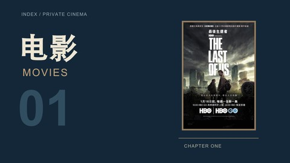](编号海报/preview.jpg)

**商店名称：** 精选 · 编号海报 · **尺寸：** 1920 × 1080 · **版本：** 1.0.0 · **作者：** [HappyQuQu](https://github.com/HappyQuQu)

大号章节数字与主副标题组成左侧字版，单张海报压住数字末端，深蓝与铜色。

素材：1 张海报。

[模板文件](编号海报/template.json) · [查看原图](编号海报/preview.jpg)

#### 双页对照

[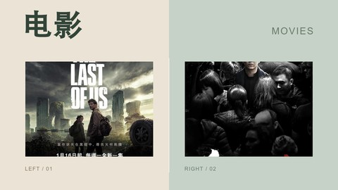](双页对照/preview.jpg)

**商店名称：** 精选 · 双页对照 · **尺寸：** 1920 × 1080 · **版本：** 1.0.0 · **作者：** [HappyQuQu](https://github.com/HappyQuQu)

两幅等宽方形画面并列，双色页底，顶部主标题与下方对应图注。

素材：2 张海报。

[模板文件](双页对照/template.json) · [查看原图](双页对照/preview.jpg)

#### 模块仪表

[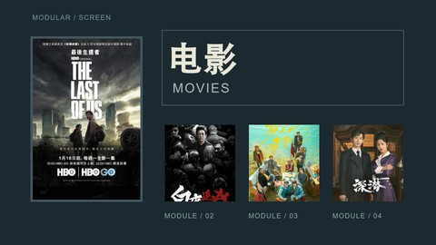](模块仪表/preview.jpg)

**商店名称：** 精选 · 模块仪表 · **尺寸：** 1920 × 1080 · **版本：** 1.0.0 · **作者：** [HappyQuQu](https://github.com/HappyQuQu)

大幅纵向主图与右側三幅小图组成模块面板，标题与编号有独立的边框区域。

素材：4 张海报。

[模板文件](模块仪表/template.json) · [查看原图](模块仪表/preview.jpg)

#### 竖幅画卷

**商店名称：** 精选 · 竖幅画卷 · **尺寸：** 1920 × 1080 · **版本：** 1.0.0 · **作者：** [HappyQuQu](https://github.com/HappyQuQu)

右侧长幅海报装入画卷，左侧标题与三幅横向小图，深棕与旧纸色边框。

素材：4 张海报。

[模板文件](竖幅画卷/template.json) · [查看原图](竖幅画卷/preview.jpg)

### 柔光与想象

[星际舷窗](#星际舷窗) · [涟漪留白](#涟漪留白) · [银色浮岛](#银色浮岛) · [复古终端](#复古终端) · [星光徽章](#星光徽章)

#### 星际舷窗

[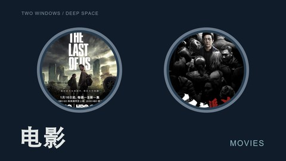](星际舷窗/preview.jpg)

**商店名称：** 精选 · 星际舷窗 · **尺寸：** 1920 × 1080 · **版本：** 1.0.0 · **作者：** [HappyQuQu](https://github.com/HappyQuQu)

两扇大圆舷窗和金属环组成双视野，标题位于底部，深蓝背景与银灰色边框。

素材：2 张海报。

[模板文件](星际舷窗/template.json) · [查看原图](星际舷窗/preview.jpg)

#### 涟漪留白

[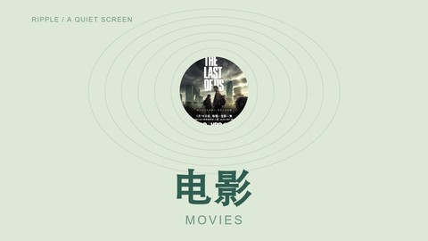](涟漪留白/preview.jpg)

**商店名称：** 精选 · 涟漪留白 · **尺寸：** 1920 × 1080 · **版本：** 1.0.0 · **作者：** [HappyQuQu](https://github.com/HappyQuQu)

小圆形主图置于大幅涟漪线条中，底部居中标题，浅绿留白。

素材：1 张海报。

[模板文件](涟漪留白/template.json) · [查看原图](涟漪留白/preview.jpg)

#### 银色浮岛

[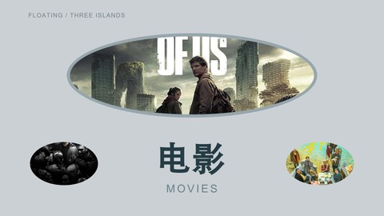](银色浮岛/preview.jpg)

**商店名称：** 精选 · 银色浮岛 · **尺寸：** 1920 × 1080 · **版本：** 1.0.0 · **作者：** [HappyQuQu](https://github.com/HappyQuQu)

一幅宽椭圆主图悬浮在上方，两幅小椭圆分列底部标题两侧，浅灰银色底光。

素材：3 张海报。

[模板文件](银色浮岛/template.json) · [查看原图](银色浮岛/preview.jpg)

#### 复古终端

[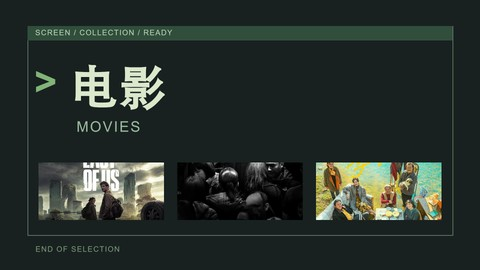](复古终端/preview.jpg)

**商店名称：** 精选 · 复古终端 · **尺寸：** 1920 × 1080 · **版本：** 1.0.0 · **作者：** [HappyQuQu](https://github.com/HappyQuQu)

终端式标题窗口与底部三幅宽图，灰黑背景、绿色状态线和简洁坐标装饰。

素材：3 张海报。

[模板文件](复古终端/template.json) · [查看原图](复古终端/preview.jpg)

#### 星光徽章

**商店名称：** 精选 · 星光徽章 · **尺寸：** 1920 × 1080 · **版本：** 1.0.0 · **作者：** [HappyQuQu](https://github.com/HappyQuQu)

主海报裁成五角星徽章，四张小图点缀两侧，上方大标题，深绿与浅金色。

素材：5 张海报。

[模板文件](星光徽章/template.json) · [查看原图](星光徽章/preview.jpg)

## 如何使用

1. 在 Library Cover Studio 打开「模板商店」，搜索上方商店名称。
2. 查看预览并点击「下载并添加」。
3. 在「模板库」打开模板，编辑设计或用于自动化任务。

也可以从 [Releases](https://github.com/HappyQuQu/library-cover-store/releases) 下载单套模板 ZIP，通过「模板库 → 导入模板」导入。详细使用与更新规则见 [README](README.md#使用模板)。

圆形或六边形海报裁切需要应用支持相对蒙版渲染；较早版本可能在自动化生成时显示为矩形。

新增模板时，请同步在本图鉴补充预览和说明，并按需更新 README 的精选预览与模板列表。
